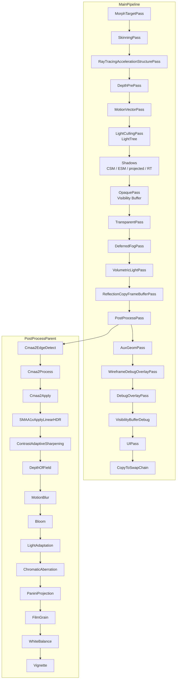
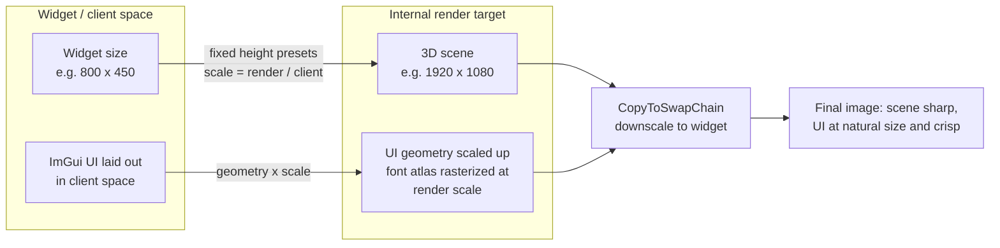
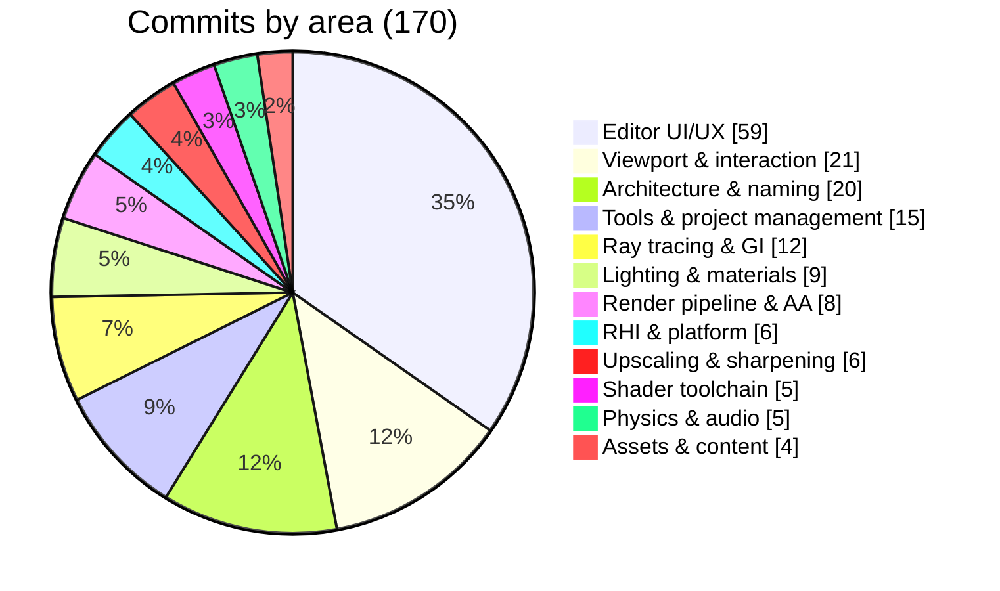
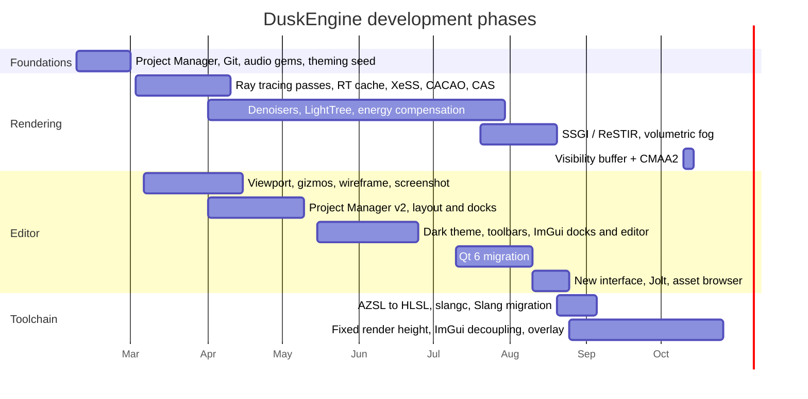

# DuskEngine

DuskEngine is a fork of [O3DE](https://o3de.org) (Open 3D Engine) with a rebuilt editor, a restructured render pipeline and a large set of new integrations. It targets real-time 3D work on Linux (X11/Wayland + Vulkan), with a strong focus on rendering quality and editor usability.

This document describes **what this fork changes**. Everything not listed here (entities/prefabs, gameplay gems, Script Canvas, Multiplayer, networking, UI (LyShine), etc.) is upstream O3DE.

**Contents**

- [At a glance](#at-a-glance)
- [Render pipeline](#render-pipeline)
- [Rendering](#rendering)
- [Editor](#editor)
- [Viewport and interaction](#viewport-and-interaction)
- [ImGui tooling](#imgui-tooling)
- [Tools and project management](#tools-and-project-management)
- [Physics and audio](#physics-and-audio)
- [Shader toolchain](#shader-toolchain)
- [Stability and platform work](#stability-and-platform-work)
- [Disabled plugins](#disabled-plugins)
- [In progress](#in-progress)
- [Commit analysis](#commit-analysis)
- [Build and run](#build-and-run)
- [License and origin](#license-and-origin)

---

## At a glance

| Area | Highlights |
|---|---|
| **Pipeline** | Visibility buffer forward/deferred restructure, pass ordering rewritten |
| **Anti-aliasing** | CMAA2 pipeline (replaces MSAA/TAA), earlier MSAA×8 + A2C / SMAA / TAA experiments |
| **Upscaling / sharpening** | Intel XeSS gem, AMD FidelityFX CAS and CACAO passes |
| **Ray tracing** | RT shadows, RT emissive, acceleration-structure pass, RT cache for Vulkan/DX12 |
| **Denoising** | SVGF temporal denoiser + accumulation, shadow and reflection denoisers, `RTShadowComposite` |
| **Global illumination** | SSGI and ReSTIR (WIP), LightTree light culling |
| **Lighting / BRDF** | Gulbrandsen Fresnel conductor, energy compensation, roughness-aware Chan BRDF, sphere-light N·H solve |
| **Reflections** | Reflection probes with Baked/RealTime/AutoSelect/SSRHybrid modes, SSSR base class |
| **Viewport** | Fixed internal render height (1080p), decoupled render resolution, view/wireframe modes, screenshots, universal manipulators |
| **Editor** | Qt 6, RenderDoc-inspired dark theme, custom Linux title bar, dock/layout overhaul, ImGui material editor and docks |
| **Tools** | New Project Manager, EngineBuildWorker, RenderDocTools, editor watchdog |
| **Physics / audio** | Jolt Physics, SoLoud audio |

---

## Render pipeline

The main pipeline was restructured around a **visibility buffer** and the post-process chain was re-ordered.



---

## Rendering

### Pipeline architecture
- **Visibility buffer pipeline** (`VisibilityBuffer.pass`, `VisibilityBuffer.azsli`, `VisibilityBuffer.shader.template`): geometry data is written into a visibility buffer and shading is resolved later, restructuring the opaque pass and the deferred lighting path.
- **Post-process pass ordering** rewritten and cleaned (comments from the visibility-buffer lighting experiments removed).
- Emissive and shadow passes got **explicit shader data mappings**, and the render pipeline settings were updated accordingly.
- **SkyBox SRG** now falls back to the binding names of the shader.

### Anti-aliasing
- **CMAA2** (Contrast-Aware Morphological AA) as the current default: `Cmaa2EdgeDetect` → `Cmaa2Process` → `Cmaa2Apply`, replacing MSAA and TAA.
- Superseded experiments kept in history: **MSAA ×8 with A2C**, **SMAA**, **TAA** (each with its pass reordering).

### Upscaling and sharpening
- **Intel XeSS** gem (`plugins/IntelXeSS`): `XeSS.pass`, `XeSSSettingsComponent`, `XeSSFeatureProcessor` and `XeSSLoader`, plus Vulkan RHI hooks.
- **AMD FidelityFX CAS** (Contrast Adaptive Sharpening): `CasPass` in the post-process chain.
- **AMD FidelityFX CACAO** (ambient occlusion): `CacaoPrepareDepths`, `CacaoGenerateQ2`, `CacaoEdgeSensitiveBlur`, `CacaoApply`.
- **AMD FSR3** was integrated (pass + settings component + `RenderViewportWidget` wiring) and later **removed** together with the vendored `FidelityFX-SDK`, which now lives in `Expiration/` as reference material.

### Ray tracing
- `RayTracingAccelerationStructurePass`, **`RayTracingShadows.pass`** and **`RayTracingEmissive.pass`** with their shaders.
- **RT cache** shared between Vulkan and DX12 backends.
- `DebugRayTracingPass` and `ReflectionScreenSpaceRayTracing` pass support.

### Denoising
- **SVGF temporal denoiser** (`SVGFTemporalDenoiser`, `SVGFTemporalAccumulation`) with a **Gulbrandsen Fresnel conductor** model for the material response.
- **Shadow Denoiser** and **Reflection Denoiser** passes, plus **`RTShadowComposite`** for compositing RT shadows.

### Global illumination
- **SSGI** and **ReSTIR** passes (`SsgiCompute`, `SsgiComposite`, `RestirInitial`, `RestirSpatial`, `RestirApply`, `RestirDebug`, `RestirParent`) — WIP, see `plans/RestirSsgiPlan.md`.
- **LightTree**: `LightTreeBuilder` builds a light tree used by the light culling pass.

### Lighting and materials
- **Gulbrandsen Fresnel conductor** and **energy compensation** (`INV_PI` refactor included).
- **Roughness-aware Chan BRDF** replaces the Lambertian diffuse term across the shaders.
- Specular contribution handling and reflection probe checks in shaders and feature processors.
- **Sphere lights**: N·H maximized with Newton iteration.
- **Volumetric fog lights** (WIP).
- **High contrast lighting presets**.
- **Default Materials Prototype** plus a materials loading fix.

### Reflections
- Reflection probe modes: **Baked / RealTime / AutoSelect / SSRHybrid**.
- **SSSR** base class (initialization in place, dispatch is a placeholder).

### RHI and platform
- **Vulkan 1.3**: `VkPhysicalDeviceVulkan13Features` queried and enabled (`synchronization2`, `dynamicRendering`, `maintenance4`).
- Vulkan query fixes and the **Vulkan dock freeze** on Linux fixed.
- **Wayland** support work (Qt 5/6 WSI surface, framework stubs).
- **VSync interval default 0** in `NativeWindow` and `RenderViewportWidget`.
- Internal render resolution decoupled from the widget: **minimum render resolution** settings and **fixed render height presets** (e.g. 1080p with free width) per viewport.

---

## Editor

### Shell and theming
- **Qt 6 migration** (with Wayland/Vulkan fixes and framework stubs).
- **RenderDoc-inspired dark theme**, later centralized into **stylesheet variables** with a **dark theme for ImGui** too.
- **Manrope** font family and consistent border radius.
- **Custom title bar** on Linux (replaces the native menu bar), showing the engine name and version; title label centering.
- **GPU information** and an update timer in the main window.
- SVG icon set (PostFX, Assets Manager, Screenshot, Folder, Camera, Play, GameSDK) and consistent folder icon color.

### Docking and layout
- `QtViewPaneManager`: layout restoration (including the Console pane), better resizing of right/bottom panels, `QGuiApplication::screenAt()` instead of the deprecated `QApplication::desktop()`, null-safety for pane instances.
- `DockTabBar`: context menu cleanup and safer tab closing; `deleteLater()` teardown for timers/layouts (crash prevention).
- Viewport top toolbar hidden by default; toolbar action priorities and icon sizes tuned.

### UI/UX
- **New editor interface** (several redesign passes): toolbar actions reorganization, undo/redo + Save All actions, entity template toolbar, transform mode cluster behavior in universal mode.
- **Entity Outliner**: hover rendering for editable entities, component icons and richer entity info, debug display for selected entities.
- **Asset Browser**: folder handling and refresh throttling improvements, engine display name in entries, drag-drop indicator color.
- **Console**: autocomplete and colored title info.
- **TrackView**: context menu to add entities from the stage.
- Viewport display information fixes (display info default setting included).
- Splash screen removed, Lua IDE removed from the editor.
- Editor startup deferred so the window shows up sooner.
- Auto-detection of the default script editor on Linux.
- QMenu crash fix.

### Naming and terminology
- **"entity" → "prim"** across UI and stage files.
- **"Gems" → "Plugins"** across the engine and the Project Manager.
- **"Levels" → "Stages"**, file extension **`.dstage`** (dialogs, prefab system, asset builder patterns).
- **O3DE → DuskEngine** branding and directory/manifest renaming.

---

## Viewport and interaction

The internal render resolution is decoupled from the widget: the scene renders at a fixed height (e.g. 1080p) and is downscaled to the widget, while the UI is laid out in screen space so it keeps its size and stays sharp.



- **Fixed internal render height** with presets (1080p, free width from the widget aspect) and a **minimum render resolution**, so the internal resolution is independent of the widget size.
- Camera, picking and manipulators work in **client space**, not render space.
- **ImGui layout decoupled from render resolution**: the UI is laid out in screen space and the font atlas is rasterized at the render scale, so text stays crisp and correctly sized at any internal resolution.
- **Viewport info overlay** (frame time/FPS, VRAM/textures, passes and draw calls, renderer + resolution + AA + pipeline, camera position/angles/clipping), drawn as a windowless ImGui HUD and driven by the same `r_displayInfo` states and *Viewport Debug Information* actions (Normal / Full / Compact / None).
- **Viewport view modes** with actions and resources, including a **wireframe view mode** and a **wireframe debug overlay** (`WireframeDebugOverlay.pass`).
- **Screenshot capture** action in the viewport.
- **Universal manipulators** (move + rotate + scale at the same time) and a **buttons gizmo** / **icon gizmo**; gizmo-hide fix; angular manipulator feedback refactor.
- Y/Z axis swap in manipulators and the property editor; viewport color definitions refactored for clarity.

---

## ImGui tooling

- **ImGui Material Editor** with node-based editing (`ImGuiMaterialNodeEditor`, `ImGuiMaterialEditorDockWidget`).
- **ImGui Stage, Attributes and Asset Browser** dock widgets (`ImGuiQtOverlay` based).
- ImGui theme support wired into the editor stylesheet variables.

---

## Tools and project management

- **New Project Manager** and **ProjectManagerLite**: tabbed navigation, project search and sorting, engine folder browsing, build output dialog, `EngineBuildWorker` and `BuildWorker` improvements (project name based output), hide-stop-button behavior.
- `ProjectBuilderWorker` builds CMake arguments through `EngineInfo` on every platform.
- **Asset Processor** launch helpers with cross-platform executable discovery.
- **RenderDocTools**: frame capture integration.
- **Editor watchdog** script for Linux (`scripts/editor_watchdog.sh`).
- **Perforce removed**, **Git support** added.
- `HybridEditorPoC` script for embedding the DuskEngine editor.
- Default script editor auto-detection on Linux.

---

## Physics and audio

- **Jolt Physics** plugin.
- **SoLoud** audio engine plugin.

---

## Shader toolchain

Shader authoring is being migrated away from Amazon's AZSL towards plain **HLSL** and then **Slang** (Slang is a superset of HLSL, so the shader bodies move first and only the SRG binding layer needs an adapter).

**Done**

- **109 `.srgi` SRG includes** (`plugins/Atom/Feature/Common/Assets/ShaderLib/...`): every Shader Resource Group is declared in a `.srgi` file and included by the shaders instead of being inlined (`SsgiComputeSrg`, `RestirSrg`, `VisibilityShadingSrg`, `RTShadowCompositeSrg`, `ShadowDenoiserFilterSrg`, `ImGuiSrg`, `SkyBoxSrg`, …).
- Bodies of the fork's own shaders (SSGI, ReSTIR, visibility buffer, RT denoisers) are **plain HLSL**; the AZSL surface is limited to the SRG semantics include.
- The migrated shaders carry an explicit compiler tag in their `.shader` descriptor (`"Compiler" : "slang"`).

**WIP**

- **Specialization constants** driven through `slangc` (plumbing in `ShaderPlatformInterface`).
- `slangc` is not yet the default: the asset pipeline still compiles with `azslc` (AZSL → HLSL + reflection) and `dxc` (HLSL → SPIR-V).

Phases, rules and validation steps: `plans/HLSLSlangMigrationPlan.md`.

---

## Stability and platform work

- **Memory leak fixes**: `ModelReloaderSystem`, `BehaviorEBusEventSender`, `StreamingImagePool`, `AssetManager`, `ShaderVariantAsyncLoader` (documented).
- **Linux crash handling** improvements.
- **Vulkan viewport freeze** on dock/resize fixed (code + documentation).
- Safe teardown (`deleteLater`) in docks and layouts.

---

## Disabled plugins

Kept in `_temp_disabled_gems/`: `AWSCore`, `Terrain`, `LandscapeCanvas`, `Vegetation` and `MiniAudio` (Vegetation and MiniAudio were added in this fork and then disabled).

---

## In progress

| Item | Status |
|---|---|
| AZSL → HLSL → Slang shader migration | WIP (`plans/HLSLSlangMigrationPlan.md`) |
| SSGI / ReSTIR global illumination | WIP (`plans/RestirSsgiPlan.md`) |
| Volumetric fog lights | WIP |
| SSSR | Base class only, dispatch placeholder |

Reference material for the implementations lives under `Expiration/` (FidelityFX SDK, Falcor, Capsaicin, SVGF, VulkanMemoryAllocator, meshoptimizer, KickstartRT, RadeonRays, RenderDoc, …).

---

## Commit analysis

The fork's history is **170 commits** (2026-02-07 → 2026-10-26), starting from an O3DE snapshot. Distribution by area:



> Every commit is listed exactly once below; the initial O3DE snapshot (`1f8cf84b`) is included in *Assets and content*.

### Development timeline



### Render pipeline and anti-aliasing (8)

| Commit | Date | Change |
|---|---|---|
| `b0af794c` | 2026-10-13 | Add visibility buffer pipeline and disable MSAA |
| `93ae041c` | 2026-10-13 | Add CMAA2 anti-aliasing pipeline, replace MSAA/TAA |
| `e823442a` | 2026-10-13 | Restructure visibility buffer pipeline, integrate CMAA2 in post-process |
| `65d820ec` | 2026-10-13 | Remove visibility-buffer lighting comments, fix post-process pass ordering |
| `e65ba7ba` | 2026-09-03 | Render pipeline settings + emissive/shadow shader data mappings |
| `fd8eeb3d` | 2026-09-02 | MSAA ×8 + A2C (superseded) |
| `bf93abb6` | 2026-06-01 | Enable SMAA, disable TAA (superseded) |
| `c017f2f6` | 2026-06-01 | Enable TAA and reorder post-processing passes (superseded) |

### Ray tracing, reflections and GI (12)

| Commit | Date | Change |
|---|---|---|
| `38d5a2ef` | 2026-08-17 | SSGI and ReSTIR |
| `598e6433` | 2026-08-30 | Specular contribution handling + reflection probe checks (WIP) |
| `97f9df95` | 2026-07-12 | Gulbrandsen Fresnel conductor + SVGF temporal denoiser |
| `64a859e3` | 2026-05-21 | SSSR class with initialization and placeholder dispatch |
| `bc4e2242` | 2026-05-21 | SSRHybrid reflection probe mode, AutoSelect default |
| `123fa77c` | 2026-05-18 | ReflectionProbe mode selection: RealTime / Baked / AutoSelect |
| `e2f31a6d` | 2026-04-06 | `RTShadowComposite` pass and shadow compositing assets |
| `a3e7d45e` | 2026-04-06 | Shadow Denoiser pass + Reflection Denoiser pass |
| `04113ba0` | 2026-03-10 | Ray Tracing Emissive pass + shaders |
| `c2f439ad` | 2026-03-10 | Ray Tracing Shadows pass + shaders |
| `0b339601` | 2026-03-10 | RT cache for Vulkan and DX12 |
| `39f77d87` | 2026-03-12 | Linux crash handling + ray tracing improvements |

### Lighting and materials (9)

| Commit | Date | Change |
|---|---|---|
| `89b048f2` | 2026-09-20 | Fix materials load |
| `f00c0c2c` | 2026-09-20 | Default Materials Prototype |
| `e89bd5e2` | 2026-08-30 | Sphere lights: maximize N·H with Newton iteration |
| `769ed00c` | 2026-07-25 | Volumetric fog light (WIP) |
| `c3888281` | 2026-07-19 | `sOneOverPi` → `INV_PI` in energy compensation + high contrast lighting presets |
| `5942e8b4` | 2026-07-12 | LightTree |
| `eac5e5b9` | 2026-07-11 | Energy Compensation |
| `4a442f2a` | 2026-04-04 | Replace Lambertian diffuse with roughness-aware Chan BRDF |
| `59d1ca1a` | 2026-03-23 | SkyBox shader SRG fallback binding names |

### Upscaling and sharpening (6)

| Commit | Date | Change |
|---|---|---|
| `8132810e` | 2026-04-07 | Contrast Adaptive Sharpening (CAS) pass |
| `e2765a55` | 2026-04-05 | FidelityFX CACAO (and removal of the vendored FSR3/SDK) |
| `7126ddd5` | 2026-03-08 | Intel XeSS gem (pass, settings component, feature processor, loader) |
| `c13da653` | 2026-03-05 | `Fsr3Pass` + `Fsr3SettingsComponent` (later removed) |
| `c5a6b04a` | 2026-03-05 | `Fsr3SettingsComponent` for FSR3 settings (later removed) |
| `4d10cbf6` | 2026-03-03 | FSR integration (later removed) |

### Shader toolchain (5)

| Commit | Date | Change |
|---|---|---|
| `c1623fee` | 2026-08-29 | Slang fix |
| `37034a63` | 2026-08-24 | Slang migration (WIP) |
| `3a7ed325` | 2026-08-24 | Specialization constants with `slangc` (WIP) |
| `2cb927e4` | 2026-08-23 | HLSL migration (WIP) |
| `cfba21e2` | 2026-08-22 | HLSL migration (WIP) |

### RHI and platform (6)

| Commit | Date | Change |
|---|---|---|
| `ce1d1bf8` | 2026-10-13 | Dock utils, Vulkan queries and Project Manager updates |
| `68e1cc4a` | 2026-07-12 | Qt5 Wayland fix, Vulkan WSISurface Wayland, Wayland framework stubs |
| `624fbe6d` | 2026-05-17 | Vulkan 1.3 (`synchronization2`, `dynamicRendering`, `maintenance4`) |
| `0c9a4ffe` | 2026-03-10 | Doc: fix viewport 3D freeze on dock/resize (Linux + Vulkan) |
| `e5c0d8e9` | 2026-03-10 | Fix resize-window Vulkan freeze on Linux |
| `2f72f319` | 2026-02-10 | VSync interval default 0 (`NativeWindow`, `RenderViewportWidget`) |

### Viewport and interaction (21)

| Commit | Date | Change |
|---|---|---|
| `6da1ccc6` | 2026-10-26 | Migrate viewport info overlay into the Atom display info gem |
| `690c47e7` | 2026-10-26 | Viewport info overlay (frame rate and resolutions) |
| `706f6331` | 2026-10-22 | Decouple ImGui UI layout from render resolution |
| `78106975` | 2026-10-20 | Fixed render height presets in the viewport |
| `b663004a` | 2026-10-10 | Swap Y/Z axes in manipulators and property editor |
| `b1dc237b` | 2026-08-30 | Minimum render resolution settings, decouple from widget size |
| `d244415c` | 2026-07-19 | Fix display info |
| `1b73b124` | 2026-05-11 | Buttons gizmo |
| `710aa6d7` | 2026-05-01 | Fix transform windows with cursor windows |
| `eef5cfa5` | 2026-04-02 | Gizmo-hide fix |
| `cd266b63` | 2026-03-28 | `AngularManipulatorCircleViewFeedback` refactor |
| `7deafdc5` | 2026-03-28 | `EditorTransformComponentSelection` refactor |
| `faabe241` | 2026-03-28 | Gizmo work |
| `e939ba56` | 2026-05-17 | Icon gizmo |
| `e72605cb` | 2026-03-21 | Wireframe debug overlay |
| `cfba1395` | 2026-03-21 | Wireframe view mode |
| `3b3127f0` | 2026-03-21 | Viewport action states and UI visibility logic |
| `9f397c8d` | 2026-03-21 | Viewport view mode functionality |
| `d370a0c8` | 2026-03-20 | Screenshot capture action + viewport display information |
| `60faf490` | 2026-04-09 | Manipulator visibility logic + `ViewportUiDisplayLayout` spacing |
| `1eeb7834` | 2026-03-06 | Universal manipulators (move + rotate + scale) |

### Editor UI and UX (59)

| Commit | Date | Change |
|---|---|---|
| `af418e2d` | 2026-10-20 | Centralize theming in stylesheet variables + ImGui theme |
| `59d167a8` | 2026-08-29 | Asset browser folder handling and update throttling |
| `c9befc02` | 2026-08-19 | Hover rendering for editable entities in the outliner |
| `057c7b47` | 2026-08-18 | Prefab UI rendering: no curved corners, capsule radius |
| `a40b4055` | 2026-08-18 | Remove toggle-switch styling from checkboxes |
| `ed8b4024` | 2026-08-18 | UI color scheme consistency |
| `9ad11ba9` | 2026-08-16 | New interface |
| `f4ef0911` | 2026-08-16 | New interface |
| `7739d539` | 2026-08-16 | New interface |
| `e8a7255e` | 2026-08-16 | New interface (WIP) |
| `2c350d9e` | 2026-08-16 | Asset browser improvements and fixes |
| `71cea94b` | 2026-08-12 | Fix QMenu crash |
| `b5eff18a` | 2026-07-14 | Defer editor startup for faster window display |
| `520ea9bd` | 2026-07-12 | Remove splash screen |
| `9283685d` | 2026-06-20 | ImGui Material Editor with node-based editing |
| `cf431a1c` | 2026-06-18 | Drag-drop indicator color + default display info |
| `e2f5da26` | 2026-05-29 | Center titlebar label, remove unused OpenParticleSystem gem |
| `ac20bb57` | 2026-05-26 | Custom menu bar widget on Linux |
| `52255810` | 2026-05-25 | Disable native menu bar on Linux |
| `4569efb9` | 2026-05-25 | TrackView context menu to add entities from stage |
| `802d1c25` | 2026-05-21 | AzQt borders and toolbar button styles |
| `d11c55d0` | 2026-05-20 | Dark theme colors + toolbar separator spacing |
| `d23bf599` | 2026-05-20 | RenderDoc-inspired dark theme |
| `e801c024` | 2026-05-19 | ImGui stage, attributes and asset browser docks |
| `60f5fbd0` | 2026-05-18 | ImGui Stage view pane |
| `aeb41666` | 2026-05-17 | Toolbar reorganization, hide viewport top toolbar |
| `b5f6f753` | 2026-05-16 | Engine name and version in window title |
| `7670ecb9` | 2026-05-16 | Console autocomplete + colored title info |
| `75ce8f3c` | 2026-05-16 | (unlabeled housekeeping) |
| `aa6ac633` | 2026-05-11 | Remove Lua IDE from the editor |
| `9524b1f8` | 2026-04-30 | DockTabBar context menu cleanup and tab closing |
| `d747e2c3` | 2026-04-10 | Undo/redo toolbar actions with icons |
| `5e068bf2` | 2026-04-09 | ComponentModeSwitcher visibility, transform cluster cleanup |
| `90f95691` | 2026-04-09 | Layout restoration and dock resizing |
| `037fcd1b` | 2026-04-09 | Layout restoration + Console view pane |
| `81c97b56` | 2026-04-04 | New SVG icons + Vulkan dock freeze fix |
| `3565f349` | 2026-04-02 | `screenAt()` instead of `QApplication::desktop()`, pane null checks |
| `662451a4` | 2026-03-28 | Entity template toolbar |
| `67518ebd` | 2026-03-28 | Toolbar icon sizes |
| `4a2e1bfc` | 2026-03-28 | Toolbar initialization and icon sizing |
| `2ced62ad` | 2026-03-27 | Assets Manager icon + toolbar settings |
| `e12253f6` | 2026-03-26 | Toolbar action priorities + viewport colors |
| `6b2a257b` | 2026-03-26 | Toolbar action refactor |
| `ec9234fe` | 2026-03-26 | Save All action + Screenshot/Folder/Camera icons |
| `acb558cd` | 2026-03-26 | PostFX icons + SVG resources |
| `570f16da` | 2026-03-26 | New SVG icons |
| `7e49b683` | 2026-03-04 | Outliner component icons and entity info |
| `3b833b3f` | 2026-03-07 | Hide transform mode cluster in universal mode |
| `b84e6491` | 2026-03-06 | Viewport color definitions refactor |
| `fdae6ac0` | 2026-03-05 | QSS dark theme color consistency |
| `77d96acf` | 2026-03-05 | UI color scheme |
| `87eafed4` | 2026-03-05 | EditorActionsHandler / `LyViewPaneNames` + PushButton styles |
| `d6ccd2d8` | 2026-02-26 | Manrope font family + border radius |
| `bd3c343f` | 2026-02-12 | Folder icons in a consistent green |
| `e829cbca` | 2026-02-12 | Engine display name in `RootAssetBrowserEntry` |
| `ee20f7a3` | 2026-02-12 | GPU information display in MainWindow |
| `e84b47b0` | 2026-02-08 | `AzAssetBrowserWindow` + `QtViewPaneManager` behavior/layout |
| `fd32cd01` | 2026-03-19 | Toolbar styling + viewport display information |
| `4a310886` | 2026-03-17 | Toolbar icon sizes + debug display for selected entities |

### Architecture, naming and stability (20)

| Commit | Date | Change |
|---|---|---|
| `87ccbb91` | 2026-10-20 | "entity" → "prim" terminology across UI and stage |
| `8b10974e` | 2026-08-04 | Qt 6 migration |
| `09654984` | 2026-07-12 | Qt 6 migration (WIP) |
| `3373182b` | 2026-07-26 | "Gems" → "Plugins" naming |
| `b0fced4a` | 2026-07-26 | "Gems" → "Plugins" naming |
| `063d64a3` | 2026-06-01 | Replace O3DE branding with DuskEngine |
| `b5fd1e20` | 2026-04-09 | Rename O3DE directories to DuskEngine (settings/manifests) |
| `6b8aa704` | 2026-03-17 | "Levels" → "Stages", `.dstage` extension |
| `71213064` | 2026-03-28 | Deactivate unnecessary plugins |
| `7648e5f1` | 2026-04-12 | Remove unused gem entries from `project.json` |
| `10ec77df` | 2026-03-22 | Memory leak fixes (ModelReloader, BehaviorEBus, StreamingImagePool, AssetManager) |
| `1e0088a5` | 2026-03-22 | Document memory leak fixes (+`ShaderVariantAsyncLoader`) |
| `068d37d6` | 2026-03-22 | Fix |
| `c2ca42aa` | 2026-03-08 | Code structure refactor |
| `56ad08a7` | 2026-04-11 | Code structure refactor |
| `0924cf23` | 2026-04-25 | `deleteLater()` for timers/layout components |
| `e8ac2dd5` | 2026-04-05 | Ignore SDK directory in git |
| `14d61807` | 2026-08-12 | Interface improvements, remove Perforce, add Git support |
| `828cb51c` | 2026-03-10 | Editor watchdog on Linux |
| `d8e0348e` | 2026-05-31 | Auto-detect default script editor on Linux |

### Tools and project management (15)

| Commit | Date | Change |
|---|---|---|
| `d8460d30` | 2026-09-05 | RenderDocTools for frame capture |
| `541f896f` | 2026-04-06 | Hide stop button in `BuildOutputDialog` |
| `581a8a53` | 2026-04-06 | `EngineBuildWorker` + build options in ProjectManagerLite |
| `3889662d` | 2026-04-06 | Project Manager / ProjectManagerLite: tabs + build output dialog |
| `8edfc773` | 2026-04-06 | `HybridEditorPoC` script to embed the editor |
| `3c5f6798` | 2026-04-06 | BuildWorker uses project name, better build output |
| `8d277fe1` | 2026-04-06 | Project Manager update |
| `3f0245d0` | 2026-04-06 | New Project Manager |
| `a2af21eb` | 2026-03-03 | Launch Asset Processor (cross-platform path discovery) |
| `0f90eb36` | 2026-02-14 | Projects screen: toolbar, search, sorting |
| `a9f21f19` | 2026-02-14 | Engine folder browsing in project settings |
| `fd86cf59` | 2026-02-14 | `ProjectBuilderWorker` uses `EngineInfo` for CMake args |
| `ddd120ca` | 2026-02-12 | "Plugins" terminology in the Project Manager |
| `7a2e4bf2` | 2026-02-12 | Project Manager UI refactor |
| `c7159aee` | 2026-04-06 | Update DuskEngine images |

### Physics and audio (5)

| Commit | Date | Change |
|---|---|---|
| `4c59c30f` | 2026-08-16 | Jolt |
| `76208db4` | 2026-08-16 | Jolt (WIP) |
| `1c3de819` | 2026-03-28 | Vegetation gem (later disabled) |
| `21092ceb` | 2026-03-01 | MiniAudio gem (later disabled) |
| `3d3e9b69` | 2026-02-10 | SoLoud audio engine gem |

### Assets and content (4)

| Commit | Date | Change |
|---|---|---|
| `04ecd912` | 2026-08-13 | meshoptimizer v1.2 |
| `5b575b2e` | 2026-03-09 | `EditorFolderComponent` and folder entity assets |
| `29859050` | 2026-03-08 | Play icon and GameSDK.ico across templates |
| `1f8cf84b` | 2026-02-07 | Initial snapshot (O3DE + DuskEngine seed) |

---

## Build and run

From the repository root:

```bash
# Build the editor (profile)
cmake --build build/linux --config profile --target Editor -- -j$(nproc)

# Run the editor
cd build/linux/bin/profile && QT_QPA_PLATFORM=xcb DRI_PRIME=1 ./Editor

# Watchdog (restarts the editor if it crashes)
scripts/editor_watchdog.sh
```

---

## License and origin

DuskEngine is based on [O3DE](https://o3de.org), licensed under the Apache License 2.0. License terms are in the `LICENSE*.TXT` files at the root of this distribution and third-party notices are in `NOTICE.txt`.
